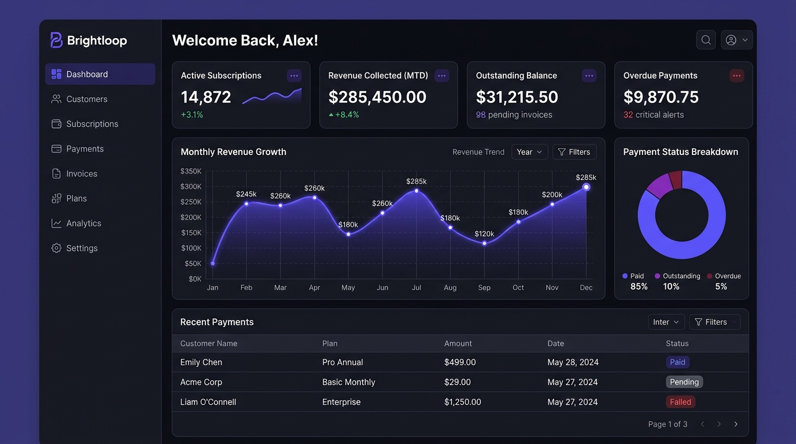
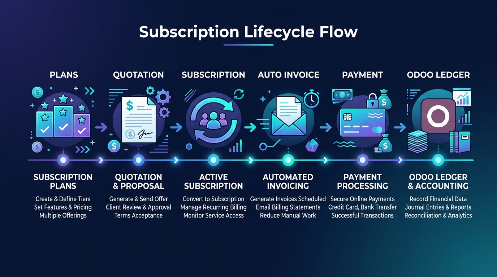

<div align="center">

# Brightloop

**The billing backbone for companies that earn their money every month.**

Plans · Subscriptions · Invoices · Payments · Revenue reports, with Odoo as the accounting ledger.


`React 18` · `Django 5 + DRF` · `PostgreSQL` · `Odoo 18` · `Firebase Auth`



</div>

---

## What problem does it solve?

Spreadsheets for subscriptions, hand-typed invoices, missed renewals, payments matched by scrolling bank statements. Brightloop replaces all of it with one system.



## Features

| | |
|---|---|
| 🔐 **Accounts & roles** | Google or email sign-up, password reset, Admin / Staff / Customer roles. |
| 📦 **Catalog** | Products, variants with price extras, plans billed daily, weekly, monthly or yearly. |
| 📝 **Quote to subscription** | Quotation templates, then Draft → Quotation → Confirmed → Active → Closed. |
| ⚙️ **Billing engine** | One click or one command creates every due invoice. **Never billed twice or skipped.** |
| 🧾 **Invoices** | Draft → Confirmed → Paid. Confirm, cancel, email, print. Tax-aware. |
| 🏷️ **Discounts** | Fixed or percent, with minimums, dates and usage limits. Applied automatically. |
| 💳 **Payments** | Partial payments, retries, reversals and a full audit trail. |
| 📊 **Dashboard** | Active subscriptions, revenue, outstanding, overdue and monthly trend. |
| 🔔 **Notifications** | Email and WhatsApp for invoices, receipts and reminders. Failures never block billing. |
| 📒 **Odoo ledger** | Taxes, products, customers and invoices mirrored to Odoo. Retries if Odoo is down. |

## Design principles

- **Exact money:** `Decimal` in the backend, strings over the API.
- **Row-level security:** every query is scoped with `for_user()`. Other users' data returns `404`.
- **Idempotent billing:** a unique constraint plus row locking prevents double billing.
- **Odoo is optional:** run with `ODOO_ENABLED=false`. Odoo failures never roll back local writes.

## Architecture

```
React + TS + Vite + Tailwind ──► Django 5 + DRF ──► PostgreSQL
        │                            │
   Firebase Auth                     └─► Odoo 18 (XML-RPC) · Email / WhatsApp
```

## Quick start

**Local:**

```bash
cp .env.example .env                      # ODOO_ENABLED=false to skip Odoo
cd backend && python -m venv .venv && .venv\Scripts\pip install -r requirements.txt
.venv\Scripts\python manage.py migrate
.venv\Scripts\python scripts/seed_demo.py
.venv\Scripts\python manage.py runserver
# second terminal
cd frontend && npm install && npm run dev   # http://localhost:5173
```

**Docker:**

```bash
cp .env.example .env
docker compose up -d --build              # web :8000, odoo :8069
make odoo-init
```

Demo logins: [docs/DEMO_SCRIPT.md](docs/DEMO_SCRIPT.md).

## CI/CD

| Workflow | Trigger | What it does |
|---|---|---|
| [`ci.yml`](.github/workflows/ci.yml) | Push to `main`, pull requests | Backend tests on Postgres, migration check, frontend type-check and build, Docker build |
| [`cd.yml`](.github/workflows/cd.yml) | CI passes on `main` | Publishes the image to GHCR and triggers the Render deploy hook |

For CD, add the repository secret `RENDER_DEPLOY_HOOK` (optional; skipped if unset).

## Deploy

Vercel (frontend) + Render (API, [`render.yaml`](render.yaml)) + Neon (Postgres) + Firebase (auth). See [docs/DEPLOY.md](docs/DEPLOY.md).

## Handy commands

| Task | Command |
|---|---|
| Tests | `cd backend && python -m pytest -q` |
| Run billing | `python manage.py run_billing` |
| Send reminders | `python manage.py run_notifications` |
| Retry Odoo sync | `python manage.py sync_odoo` |

## Known limits

Single currency (INR), manual payment recording (no gateway), no proration.

## Docs

[PRD](docs/PRD.md) · [Architecture](docs/ARCHITECTURE.md) · [Data model](docs/DATA_MODEL.md) · [Billing engine](docs/BILLING_ENGINE.md) · [Odoo](docs/ODOO_INTEGRATION.md) · [RBAC](docs/RBAC.md) · [API](docs/API.md) · [Deploy](docs/DEPLOY.md) · [Decisions](docs/DECISIONS.md)
